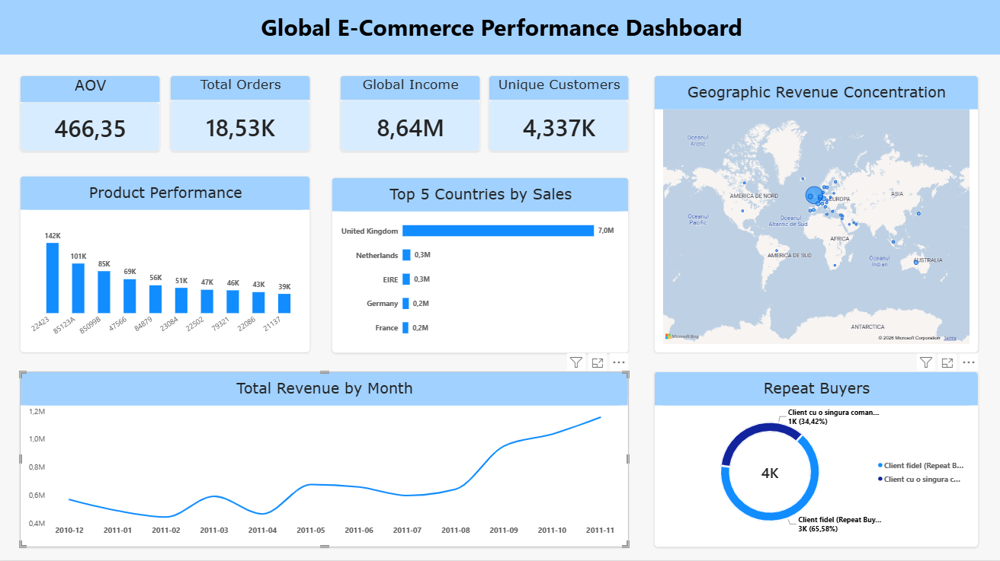
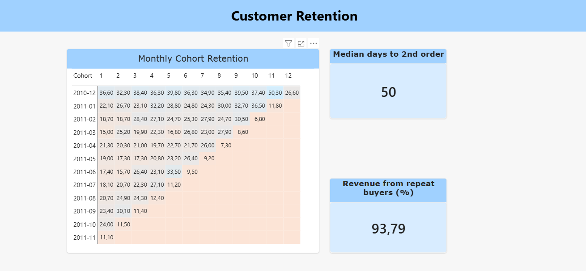

# E-Commerce Growth Analytics: Revenue, Retention & Cohorts

End-to-end analytics project on one year of transactions from a UK online retailer (Dec 2010 – Dec 2011, ~400K order lines, currency **GBP**):
**Python** (EDA & cleaning) → **SQL Server** (validated analytical layer, window functions, cohort retention) → **Power BI** (2-page executive report).

---

## 📊 Dashboard

### Page 1: Performance


### Page 2: Customer Retention


---

## 🔍 Data audit: what I found and fixed (v1 → v2)

The first version of this dashboard showed **£821.5M revenue**. When I reconciled the SQL output against the Python totals, they didn't match. The real figure is **£8.64M**. Root causes:

| # | Issue | Impact | Fix |
|---|---|---|---|
| 1 | `UnitPrice` imported into SQL Server with the wrong decimal separator (`2.55` → `255`) | Revenue inflated **~92x** | Load the CSV as text into a staging table, convert explicitly with `TRY_CONVERT`, validate totals against Python |
| 2 | "AOV" calculated as the average **order line** value | Wrong KPI definition | AOV = revenue / distinct orders |
| 3 | Two huge orders (80,995 and 74,215 units) were cancelled in the source data. Cleaning removed the cancellation rows but kept the originals | Fake "#1 best-seller" | Removed the cancelled orders |
| 4 | 5,192 exact duplicate rows | Small overstatement | De-duplicated with `ROW_NUMBER()` |
| 5 | Monthly chart used the month **name**, merging Dec-2010 and Dec-2011 (a 9-day partial month) | Misleading trend | Axis on `YearMonth`, partial month flagged and excluded |
| 6 | "Days between orders" numbered order **lines**, not orders | 98% of results = 0 days | Aggregate to order level first |
| 7 | Postage (`POST`) and manual adjustments (`M`) ranked as top products | Noise in rankings | `IsProduct` flag |

The SQL script contains **checkpoints with expected values** after each step and a final **reconciliation test**: every view must add up to the same total revenue (£8,641,555.69).

---

## 📈 Key results

| KPI | Value |
|---|---|
| Revenue | **£8.64M** |
| Orders | **18,530** |
| Customers | **4,337** |
| AOV | **£466** |
| Orders per customer | **4.3** |

## 💡 Insights

1. **Repeat customers are the business.** 65.6% of customers ordered more than once, and they generated **93.8% of revenue**. The top 10% of customers alone bring **60% of revenue**.
2. **Cohort retention:** on average **~21%** of a monthly cohort orders again the next month, and retention then **stabilises at 20–30%** instead of decaying to zero: a solid repeat base.
3. **Reading the cohorts carefully:**
   - The Dec-2010 cohort stays at 35–40% every month. These are mostly existing customers captured when the data starts (**left-censoring**), not truly new ones.
   - The last diagonal of the matrix (Dec 2011) looks low only because that month has 9 days of data.
4. **Repeat cycle:** the **median** time between a customer's 1st and 2nd order is **50 days** (the mean is 76, pulled up by a few customers returning after many months). That's the natural window for a reactivation campaign.
5. **Seasonality:** Sep–Nov 2011 produced **36%** of the year's revenue. November peaked at £1.16M, driven by **more orders** (+38% vs October), not bigger baskets: AOV actually fell from £537 to £435.
6. **Concentration:** the UK makes up **81.5%** of revenue, followed by the Netherlands, Ireland, Germany and France.
7. **Timing:** no orders on Saturdays (the store doesn't trade then). Thursday is the strongest day, and late morning to early afternoon is the peak.

---

## 🏗️ Architecture

```
Online_retail_cleaned.csv (Python output)
        │  BULK INSERT (all columns as text)
        ▼
stg_online_retail  ──TRY_CONVERT──►  Online_retail_typed  ──dedup + clean──►  Online_retail_cleaned
                                                                                  │
                                                                                  ▼
                                                                         analytical views
                                                                                  │
                                                                                  ▼
                                                                          Power BI report
```

**Files**
- `EDA.py`: cleaning (missing customers, cancellations, non-positive quantities/prices) and feature engineering
- `SQL_Scripts_v2.sql`: the full SQL layer, with checkpoints:
  - `vw_KPI`: headline KPIs (revenue, orders, customers, AOV)
  - `vw_TrendLunar`: monthly revenue, orders, AOV, partial-month flag
  - `vw_TrendMoM`: month-over-month growth (`LAG`)
  - `vw_TopProduse`: product ranking (non-product codes excluded)
  - `VW_VANZARI_PE_TARI`: revenue and share by country (`SUM() OVER()`)
  - `vw_RetentieClienti`: one-time vs repeat buyers, share of customers and revenue
  - **`vw_CohortRetention`**: monthly cohort retention matrix
  - `vw_TimeToSecondOrder`: days from 1st to 2nd order (`ROW_NUMBER`)
- `E-Commerce_Executive_Dashboard_v2.pbix`: Power BI report (Performance + Customer Retention)

---

## 🚀 How to run

1. Run `EDA.py` on the raw dataset to produce `Online_retail_cleaned.csv`.
2. In SSMS, run `SQL_Scripts_v2.sql` **block by block** (update the CSV path in BLOCK 2). Each checkpoint shows the expected values.
3. Open the `.pbix` file and refresh the connection to your local SQL Server instance.

## ⚠️ Limitations

- Revenue is **gross**: cancellations and returns were removed rather than netted against the original orders (full netting needs the raw file).
- Many customers appear to be wholesalers, so B2C benchmarks don't apply directly.
- The data covers only 12 months, so year-over-year seasonality can't be separated from growth.
